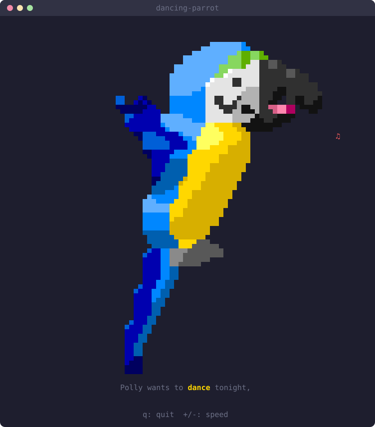

# dancing-parrot



An animated dancing blue-and-yellow macaw for your Linux terminal. It sways,
stomps, flaps, every few seconds spins a full 360° turn, and sings: its beak
moves in time with a synthesised song while the lyrics run karaoke-style
underneath.

The parrot is a real 3D voxel model: side-view pixel art is "inflated" into
rounded body parts, ray cast from the current angle and lit from the upper
left, then drawn with UTF-8 half-block characters (`▀▄`, two pixels per
character cell).

```
               ▄▄███▓▄▄                        ▄▄▄▄▄▄                           ▄████▓▄
             ▄█████▓▓▓▒▓▒▄▄                   ████▓▓▒▄                         ▄▓███▓▒▒▒▄
             █████▓▓▓▒▒▒▓▓▓▓▄                █████▓▓▒▒                         ▓▓▓██▒▒▒▒▒
             ▓▓▓▓▓▒▒▒▒▒▒▒ ▀▀▒                ███▓▓▓▒▒▒                         ▀▓▓▓▒▒▒▒▒▀
            ██▓▓▓▓▓▓▒▒▀▀▀                     ████▓▒▒▒                          ▀▒▒▒▒▒▒▀
          ▄█▓▓▓▓██▓▓▓▒                      ▄▄▄█▓▓▓▒▓▄▄                        ██▓▓▒▒▒▒▒▒▒
          ▓▓▓▓▓▓▓▓▓▒▒▒                      █▓▓▓▓▓████▒                        ██▓▓▓▓▒▒▒▒▒
          ▓▓▓▓▓▓▓▒▒▒▒                       ▓▓▓▓▓████▓▒                        ▒▒▓▓▒▒▒▒▒▒▒
         █▓▓▓▓▓▒▒▒▒▒                        █▓▓▓▓▓▓███▒                        ▓▓▓▓▒▒▒▒▒▒▒
         ▓▓▓▓▓▒▒▒▒▒                         █▓▓▓▓▓████▒                        ▓▓▓▓▒▒▒▒▒▒▒
        ▄▓▓▒▒▒▒▒▒▀                          █▓▓▓▓▓▓▓██▒                        ▒▒▒▒▒▒▒▒▒▒▒
        █▒▒▒▒▒▒▒  ▄                         █▓▒▒▒▓▓▓▓█▒                        ▒▓▓▓▒▓▒▒▒▒▒
        ▓▀▒▒▓▓▀▀▀ ▓▄▄                       ▓▒▒▒▓▓▓▓▓▓▒                        ▓▓█▀▒▓▒▀▒▒▒
         ▄▓▓▓▀                              ▀▀▀ █▓▒ ▀▀▀                            ▓▒▒
         ▓▓▓▀                                   █▓▒                                ▓▒▒
        ▄▓▓▀                                    █▓▒                                ▓▒▒
        ▓▓▀                                     █▓▒                                ▓▒▒
        ▓▀                                      ▓▓▒                                ▓▒▒
        ▀                                       ▓▓▒                                ▀▀▀
```

(Side, back and front views, shown in `--no-color` mode; normally it is
drawn in full colour.)

Pure Python standard library, with no runtime dependencies on Linux and
macOS. On Windows `windows-curses` is installed automatically, since Python
there ships without `curses`.

## Install

```sh
pipx install .          # or: pip install .
pipx install '.[sound]' # optional: cross-platform audio via sounddevice
dancing-parrot
```

Or run it without installing:

```sh
PYTHONPATH=src python3 -m dancing_parrot
```

## Usage

```
dancing-parrot [-f FPS] [-d SECONDS] [--no-color] [--no-spin] [-m] [-V]
```

| Option | Description |
| --- | --- |
| `-f, --fps` | Animation speed, 1–60 frames per second (default 15) |
| `-d, --duration` | Stop automatically after this many seconds |
| `--no-color` | Disable colours (the `NO_COLOR` env var also works) |
| `--no-spin` | Skip the 360° pirouette |
| `-m, --mute` | Sing silently (beak and lyrics only) |

Keys: `q` / `Esc` quit, `+` / `-` change speed. The parrot is scaled up
(up to 6x) to fit the terminal using the Scale2x/Scale3x pixel-art
algorithms, so edges get finer rather than blockier, and stays centred when it is resized.
Uses 256 colours when available, falling back to 8 colours, or shading
characters with `--no-color`. Requires a UTF-8 locale (on Windows, use
Windows Terminal).

Sound works on Linux, macOS and Windows with no extra packages, using the
first backend that works:

| Backend | Platform | Notes |
| --- | --- | --- |
| `sounddevice` | all | Optional extra (`pip install '.[sound]'`); streams via PortAudio with the tightest beak sync |
| `aplay` / `pw-cat` / `paplay` | Linux | Raw PCM streamed through a pipe |
| `afplay` | macOS | Built in; a temporary WAV restarted each loop |
| `winsound` | Windows | Python standard library; a looping temporary WAV |

The song (original tune and lyrics) is synthesised at startup with the
standard library. If no backend works the parrot simply sings silently.

Exit codes: `0` success, `1` no terminal or a terminal error, `2` bad
arguments, `130` Ctrl-C, `143` SIGTERM. The terminal is restored in every case.

## Development

```sh
pip install -e '.[dev]'
pytest
ruff check . && ruff format --check .
mypy
```

`docs/screenshot.svg` is drawn from the app's own frame data; regenerate it
with `PYTHONPATH=src python3 scripts/screenshot.py`.

## Layout

- `src/dancing_parrot/sprites.py` has the side-view pixel art, one sprite per body part
- `src/dancing_parrot/model.py` inflates sprites into voxels, ray casts them from any angle and shades them
- `src/dancing_parrot/frames.py` handles choreography (pose, sway, spin) and pixel-art upscaling as pure functions, so they can be tested without a terminal
- `src/dancing_parrot/song.py` has the melody, lyrics and synthesiser; `audio.py` picks an audio backend, plays the song and keeps the song clock
- `src/dancing_parrot/renderer.py` contains the curses loop: drift-free frame timing, input, resize handling and colour
- `src/dancing_parrot/cli.py` handles argument parsing, TTY/locale checks and signal handling

## License

[MIT](LICENSE) © 2026 Philipp Lopaur
